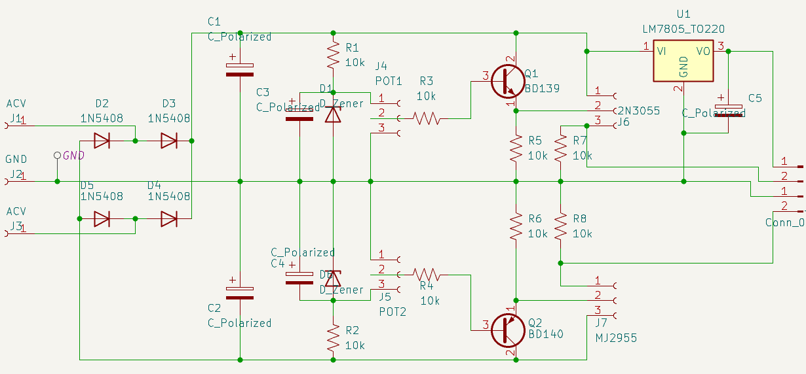

# +/-15 V Linear Power Supply

A compact linear bench supply with a custom PCB and enclosure. The front panel provides a fixed **+5 V** output and adjustable outputs labeled **0 to 15 V** and **-15 to 0 V**.

## PCB and schematic

| PCB, component side | PCB, solder side |
|:--:|:--:|
|  |  |

## Enclosure views

| Front panel | Rear panel |
|:--:|:--:|
|  |  |

## Project files

- [KiCad project](Power%20supply.kicad_pro)
- [Schematic](Power%20supply.kicad_sch)
- [PCB layout](Power%20supply.kicad_pcb)
- [Enclosure STEP model](exports/3d/Power%20supply.step)
- [PDF drawing](exports/pdf/PSU.pdf)